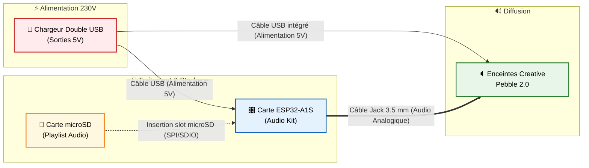

# Architecture Matérielle & Branchements

Ce document détaille l'ensemble des composants utilisés pour le lecteur audio autonome ainsi que le schéma de câblage complet de l'installation.

---

## 📦 Liste du matériel (BOM)

| Composant | Modèle / Référence | Rôle dans l'installation | Lien |
| :--- | :--- | :--- | :--- |
| **Microcontrôleur Audio** | Carte de développement ESP32-A1S (Audio Kit) | Cerveau du système : lit les fichiers audio et gère la sortie son via son DAC intégré. | [Voir sur Amazon](https://www.amazon.fr/dp/B0DF58DCQ7?ref=ppx_yo2ov_dt_b_fed_asin_title) |
| **Stockage** | Carte microSD SanDisk (64 Go) | Stocke la playlist et les morceaux découpés (formatée en FAT32). | [Voir sur Amazon](https://www.amazon.fr/SanDisk-Extreme-RescuePRO-Deluxe-jusquà/dp/B0B7NXBM6P/ref=sr_1_5) |
| **Diffusion sonore** | Enceintes stéréo Creative Pebble 2.0 | Restituent le signal audio analogique issu de l'ESP32. | [Voir sur Amazon](https://www.amazon.fr/CREATIVE-Enceintes-Haut-parleurs-Connection-100-17000/dp/B0791J2658/ref=asc_df_B0791J2658) |
| **Alimentation** | Chargeur secteur double port USB (Nisiyama) | Fournit l'alimentation 5V simultanée à l'ESP32 et aux enceintes. | [Voir sur Amazon](https://www.amazon.fr/Chargeur-Charger-Adaptateur-Alimentation-Nisiyama/dp/B0BXD4XRM2/ref=sr_1_2_sspa) |

---

## 🔌 Schéma des branchements

GitHub génère automatiquement le diagramme ci-dessous grâce à la syntaxe **Mermaid** :

---

## 🛠️ Guide de montage pas à pas

1. **Préparation du stockage :**
   * Insérez la **carte microSD** (préalablement formatée en `FAT32` et contenant vos fichiers audio) dans le lecteur de carte intégré à la carte **ESP32**.
2. **Liaison Audio :**
   * Branchez le câble **Mini-Jack 3.5 mm** provenant des enceintes **Creative Pebble** sur la prise casque / sortie ligne (`EARPHONE` / `LINE OUT`) de la carte **ESP32**.
3. **Alimentation électrique :**
   * Branchez le **chargeur double USB** sur une prise murale.
   * Reliez le câble d'alimentation USB de l'**ESP32** (port `PWR` ou `USB`) sur le **Port USB n°1** du chargeur.
   * Reliez le câble USB des **enceintes Creative Pebble** sur le **Port USB n°2** du chargeur.

> **💡 Note technique :** Le fait d'alimenter l'ESP32 et les enceintes via le même bloc secteur permet de partager une masse commune, ce qui réduit généralement les risques de parasites audio (boucle de masse), tout en garantissant un courant suffisant sur chaque port pour éviter les chutes de tension lors des pics sonores.