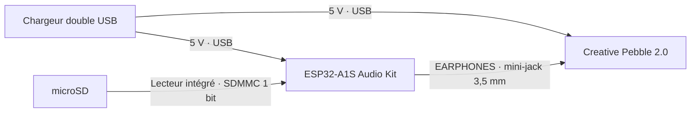

# Disco — Matériel et branchements

Ce guide décrit le montage retenu pour Disco avec une carte **ESP32-A1S Audio Kit V2.2** et des enceintes amplifiées. La préparation de la carte SD et les formats audio sont décrits une seule fois dans le [README](README.md#préparer-la-carte-sd).

## Matériel

| Composant | Référence retenue | Rôle | Prix public | Lien |
|---|---|---|---|---|
| Carte audio | ESP32-A1S Audio Kit | Lit les WAV et pilote son codec audio AC101 ou ES8388 ; la sortie utilise ce codec, pas le petit DAC interne de l'ESP32. | ~28,00 € | [Référence Amazon](https://www.amazon.fr/dp/B0DF58DCQ7) |
| Stockage | microSD SanDisk 64 Go | Stocke les fichiers audio ; vérifier le format de la carte avant usage. | ~12,99 € | [Référence Amazon](https://www.amazon.fr/dp/B0B7NXBM6P) |
| Enceintes | Creative Pebble 2.0 | Enceintes amplifiées avec entrée audio mini-jack et alimentation USB. | ~24,99 € | [Référence Amazon](https://www.amazon.fr/dp/B0791J2658) |
| Alimentation | Chargeur secteur double USB Nisiyama | Alimente séparément la carte et les enceintes via ses deux ports. | ~13,99 € | [Référence Amazon](https://www.amazon.fr/dp/B0BXD4XRM2) |
| Boule à facettes | Eurolite Mirror Ball 30 cm gold | Boule à facettes | 39,00 € | [Référence Thomann](https://www.thomann.fr/eurolite_mirror_ball_30_cm_gold.htm) |
| Moteur | Eurolite MD-1030 Mirror Ball Motor 3kg | Moteur rotatif avec fiche d'alimentation | 14,90 € | [Référence Thomann](https://www.thomann.fr/eurolite_md_1030_mirror_ball_motor_3kg.htm) |
| Lumière | Eurolite LED PST-5 QCL Spot WH | Projecteur LED | 45,00 € | [Référence Thomann](https://www.thomann.fr/eurolite_led_pst_5_qcl_spot_wh.htm) |

Les liens identifient les références choisies ; vérifier les caractéristiques et la révision effectivement livrées. Prévoir **5 V / 2 A disponibles pour la carte**, plus le courant demandé par les enceintes.

## Branchements

1. Hors tension, insérer la microSD préparée selon le [README](README.md#préparer-la-carte-sd).
2. Brancher le mini-jack des enceintes sur **EARPHONES**. **LINEIN** est une entrée ; les connecteurs **LOUT/ROUT** ne sont pas la sortie casque mini-jack.
3. Relier le port d'alimentation **POWER** de la carte à une sortie USB du chargeur. Le port **UART/POWER** peut aussi l'alimenter ; respecter les indications de la révision utilisée.
4. Relier l'USB des enceintes à l'autre sortie du chargeur, puis mettre le chargeur sous tension.
5. Régler d'abord le volume des enceintes à un niveau modéré, puis ajuster celui de Disco dans l'interface Web.

Pour programmer la carte, utiliser **UART/POWER** avec un câble micro-USB de données. Le port POWER seul ne programme pas la carte.

Un chargeur commun simplifie l'installation, mais ne garantit ni l'absence de bruit ni un courant suffisant. Un ronflement peut dépendre de l'alimentation, des câbles et des masses du montage. Une alimentation insuffisante peut provoquer des redémarrages, notamment avec le Wi-Fi actif.

### Interrupteurs DIP

Pour la carte portant les liaisons suivantes, lire le repère ON imprimé sur le boîtier :

| Interrupteur | Liaison | Position |
|---|---|---|
| 1 | IO13 / KEY2 | OFF |
| 2 | IO13 / DATA3 | ON |
| 3 | IO15 / CMD | ON |
| 4 | IO13 / MTCK | OFF |
| 5 | IO15 / MTDO | OFF |

La SD utilise le mode 1 bit : CLK14, CMD15, D0=2. Aucun pilotage d'alimentation sur GPIO13. Si la sérigraphie diffère, vérifier le schéma de la révision avant de reprendre ces positions.

## Profils audio

| Profil | Codec | SDA / SCL | BCLK / LRCK / sortie | MCLK |
|---|---|---|---|---|
| 1 | AC101, adresse 0x1A | 33 / 32 | 27 / 26 / 25 | 0 |
| 2 | ES8388 variante 5, adresse 0x10 ou 0x11 | 33 / 32 | 27 / 25 / 26 | 0 |
| 3 | ES8388 variante 7, adresse 0x10 ou 0x11 | 18 / 23 | 5 / 25 / 26 | 0 |

`CODEC_PROFILE=0` essaie ces profils. Un seul candidat doit répondre. AC101 est vérifié par sa signature ; ES8388 par une lecture à l'adresse attendue, sans identifiant unique. Il ne s'agit pas d'une reconnaissance universelle des cartes. Aucun autre périphérique I2C ne doit être ajouté sur ces broches.

En cas de détection impossible ou ambiguë, consulter le moniteur série. Fixer `CODEC_PROFILE` à 1, 2 ou 3 uniquement lorsque la révision est connue. Après une erreur de lecture, l'état du lecteur apparaît aussi sur la page.

## Premier essai

Consulter les [vérifications sur matériel](README.md#vérification-sur-matériel). La configuration est prévue pour les profils ci-dessus ; le fonctionnement électrique et audio doit être vérifié sur la carte réellement utilisée.
