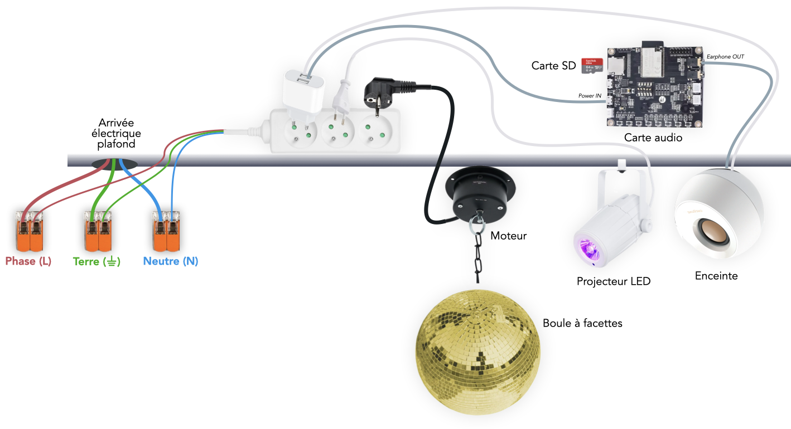
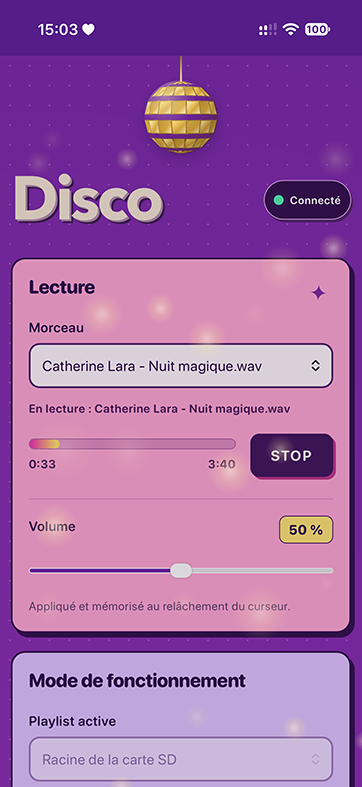
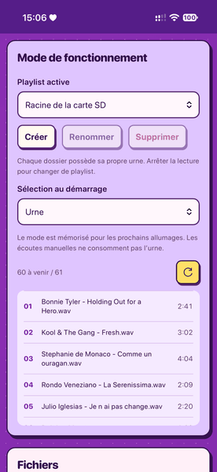
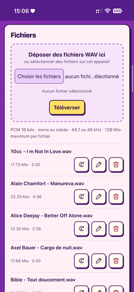

# Disco — Installation interactive pour les toilettes

À chaque allumage de la lumière, une boule à facettes tourne et un extrait musical démarre. Le morceau est tiré au sort dans une playlist préparée à l’avance. L’extinction coupe l’ensemble ; au prochain allumage, un nouveau tirage a lieu, sans reprise du morceau interrompu.

Disco repose sur une **ESP32-A1S Audio Kit V2.2**, une carte microSD et des enceintes amplifiées. Le programme se compile avec **Arduino IDE et le cœur ESP32 2.0.17**. Une interface Web locale gère les sons, les playlists, le mode de tirage et le volume.

Le moteur et le projecteur sont alimentés avec l’installation : **la carte audio ne commande pas leur rotation ni leur éclairage**. Elle lit un seul fichier WAV jusqu’à sa fin, puis s’arrête. La durée de l’extrait dépend donc du fichier préparé, sans minuterie ni découpage automatique.

## Sommaire

- [Installation physique](#installation-physique)
- [Préparation des sons](#préparation-des-sons)
- [Préparation de la carte SD](#préparation-de-la-carte-sd)
- [Installation du programme](#installation-du-programme)
- [Réglages du lecteur](#réglages-du-lecteur)
- [Wi-Fi et identifiants sur la carte SD](#wi-fi-et-identifiants-sur-la-carte-sd)
- [Playlists et modes de tirage](#playlists-et-modes-de-tirage)
- [Interface Web](#interface-web)
- [Mise à jour de l’interface Web](#mise-à-jour-de-linterface-web)
- [Démarrage et coupures de courant](#démarrage-et-coupures-de-courant)
- [Diagnostic et vérification](#diagnostic-et-vérification)
- [Organisation du projet et publication](#organisation-du-projet-et-publication)
- [Licence](#licence)

## Installation physique

### Matériel

Les références ci-dessous correspondent au montage dans sa version originale :

| Composant | Référence retenue | Rôle | Prix indicatif | Lien |
|---|---|---|---|---|
| Carte audio | ESP32-A1S Audio Kit | Lit les WAV et pilote son codec audio AC101 ou ES8388 | 30 € | [Référence Amazon](https://www.amazon.fr/dp/B0DF58DCQ7) |
| Stockage | microSD SanDisk 64 Go | Stocke les fichiers audio | 20 € | [Référence Amazon](https://www.amazon.fr/dp/B0B7NXBM6P) |
| Enceintes | Creative Pebble 2.0 | Enceintes amplifiées avec entrée audio mini-jack et alimentation USB | 25 € | [Référence Amazon](https://www.amazon.fr/dp/B0791J2658) |
| Câble USB | USB-A vers micro-USB | Relie la carte audio à l'alimentation | 6 € | [Référence Amazon](https://www.amazon.fr/dp/B0C6HYYTMM?ref=ppx_yo2ov_dt_b_fed_asin_title) |
| Alimentation | Chargeur secteur double USB | Alimente la carte et les enceintes via deux ports USB | 10 € | [Référence Amazon](https://www.amazon.fr/dp/B0BXD4XRM2) |
| Multiprise | Multiprise 3 prises | Permet de brancher les équipements | 10 € | [Référence Amazon](https://www.amazon.fr/PremiumCord-PP3-03-Blanc/dp/B084395JDG/ref=sxin_12_pa_sp_search_thematic_sspa) |
| Boule à facettes | Eurolite Mirror Ball 30 cm Gold | Boule à facettes | 40 € | [Référence Thomann](https://www.thomann.fr/eurolite_mirror_ball_30_cm_gold.htm) |
| Moteur | Eurolite MD-1030 Mirror Ball Motor 3 kg | Moteur rotatif pour boule à facettes | 15 € | [Référence Thomann](https://www.thomann.fr/eurolite_md_1030_mirror_ball_motor_3kg.htm) |
| Lumière | Eurolite LED PST-5 QCL Spot WH | Projecteur LED 5 W | 45 € | [Référence Thomann](https://www.thomann.fr/eurolite_led_pst_5_qcl_spot_wh.htm) |

### Alimentation et branchements

Le montage présenté est commandé par l’interrupteur mural. Son raccordement à l’installation fixe relève d’une personne compétente en électricité. Les travaux se déroulent hors tension, après mise en sécurité du circuit contre une remise sous tension et vérification de l’absence de tension avec un appareil adapté. La couleur des fils ne suffit pas à identifier les conducteurs — la présence de la phase commandée, du neutre et, lorsque les équipements l’exigent, de la terre se vérifie sur l’installation réelle.



## Préparation des sons

### Sélection musicale

L’effet repose sur des extraits qui commencent à un moment fort : refrain, montée ou percussion marquante. Le début et la durée sont préparés dans les fichiers source. Ni le lecteur ni le script de conversion ne recherchent ces passages automatiquement.

Quelques propositions de morceaux :

| Artiste | Titre |
| :--- | :--- |
| 10cc | I’m Not in Love |
| Alain Chamfort | Manureva |
| Alice Deejay | Better Off Alone |
| Axel Bauer | Cargo de nuit |
| Bibie | Tout doucement |
| Bonnie Tyler | Total Eclipse of the Heart |
| Bonnie Tyler | Holding Out for a Hero |
| Bronski Beat | Smalltown Boy |
| Catherine Lara | Nuit magique |
| Céline Dion | All by Myself |
| Corona | The Rhythm of the Night |
| Corynne Charby | Boule de flipper |
| Dalida | Depuis qu’il vient chez nous |
| Dalida | Laissez-moi danser |
| Dalida | Mourir sur scène |
| Daniel Balavoine | Tous les cris les SOS |
| Daniel Balavoine | Quand on arrive en ville |
| Demis Roussos | Quand je t'aime |
| Desireless | Voyage, Voyage |
| Diana Ross | I'm Coming Out |
| Diane Tell | Si j’étais un homme |
| Eddy Mitchell | Couleur menthe à l'eau |
| Elsa | T’en va pas |
| Frankie Goes to Hollywood | Relax |
| Gala | Freed from Desire |
| George Michael | Careless Whisper |
| Gilbert Montagné | Je veux tout |
| Ginette Reno | J'ai besoin de parler |
| Herbert Léonard et Julie Pietri | Amoureux fous |
| Imagination | Just an Illusion |
| Isabelle Adjani | Pull marine |
| Jakie Quartz | Mise au point |
| Jean-Jacques Goldman | Envole-moi |
| Julie Pietri | Ève lève-toi |
| Julio Iglesias | Je n’ai pas changé |
| Kate Bush | Wuthering Heights |
| Klaus Nomi | The Cold Song |
| Kool & The Gang | Fresh |
| Laura Branigan | Self Control |
| Mariah Carey | Without You |
| Michael Sembello | Maniac |
| Ministry | I Wanted to Tell Her |
| Mireille Mathieu | Bravo tu as gagné |
| Mylène Farmer | Désenchantée |
| Mylène Farmer | Sans contrefaçon |
| Patrick Juvet | I Love America |
| Phil Collins | In the Air Tonight |
| Robert Miles | Children |
| Rondò Veneziano | La Serenissima |
| Sash! | Encore une fois |
| Sheila & B. Devotion | Spacer |
| Stéphanie de Monaco | Comme un ouragan |
| Taxi | Cherchez le garçon |
| Tears for Fears | Everybody Wants to Rule the World |
| The Pointer Sisters | I'm So Excited |
| The Weather Girls | It's Raining Men |
| Thierry Hazard | Le Jerk ! |
| Véronique Sanson | Vancouver |
| Whitney Houston | I Wanna Dance With Somebody |
| Whitney Houston | I Will Always Love You |

### Format audio et noms de fichiers

Le lecteur accepte les **WAV PCM entier signé 16 bits, mono ou stéréo, à 44,1 ou 48 kHz**. Les MP3, le PCM 24 bits, les échantillons flottants et le format WAV extensible ne sont pas pris en charge. Les WAV incompatibles sont exclus des tirages.

Les espaces et les accents sont acceptés. Des noms courts facilitent les échanges HTTP ; les noms commençant par un point et les caractères `/ \ : * ? " < > |` sont à exclure. Le serveur accepte jusqu’à 255 octets pour un nom de WAV, mais un nom fortement encodé peut atteindre plus tôt la limite des en-têtes HTTP.

La sélection accepte **1 024 WAV compatibles au maximum par playlist**. La liste Web est également limitée à 1 024 entrées. La limite de téléversement est de **128 Mio par fichier**, soit 134 217 728 octets. Cette limite concerne l’envoi Web ; la copie directe depuis un ordinateur ne passe pas par ce contrôle.

Une conversion simple avec FFmpeg s’écrit :

```sh
ffmpeg -i entree.wav -ar 44100 -c:a pcm_s16le sortie.wav
```

Cette commande conserve le nombre de canaux de la source. L’option `-ac 1` impose le mono ; `-ac 2` impose la stéréo. Les fichiers mono et stéréo cohabitent sans réglage supplémentaire. Cette conversion seule ne normalise pas le niveau sonore.

## Préparation de la carte SD

La carte utilise **FAT32**, avec une partition principale ; une table MBR constitue le choix recommandé. Le programme ne formate pas la carte et ne prend pas en charge exFAT. Une microSD de 64 Go convient après formatage en FAT32. Le formatage efface les données : une sauvegarde préalable conserve le contenu existant.

Les WAV se placent soit à la racine, soit dans des dossiers de playlists directement à la racine. Le dossier **`www/`** contient l’interface Web. Exemple :

| Chemin sur la carte | Usage |
| --- | --- |
| `/Titre.wav` | Playlist « Racine de la carte SD » |
| `/Quotidien/Titre.wav` | Playlist « Quotidien » |
| `/Soiree/Titre.wav` | Playlist « Soiree » |
| `/www/index.html, /www/style.css`, `/www/app.js`, `/www/icon-192.png` | Page Web et ses ressources |
| `/wifi.txt` | Import facultatif des identifiants Wi-Fi |

Le dossier `www` est réservé à l’interface ; les sous-dossiers imbriqués ne sont pas parcourus pour la musique. **La carte s’insère toujours avant la mise sous tension, sans remplacement à chaud.**

## Installation du programme

### Environnement Arduino

1. L’environnement utilisé est Arduino IDE 2.x.
2. L’URL suivante figure dans **Préférences → URL de gestionnaire de cartes supplémentaires** :

   ```text
   https://espressif.github.io/arduino-esp32/package_esp32_index.json
   ```

3. Le gestionnaire de cartes contient **esp32 par Espressif Systems, version 2.0.17 exactement**. Cette version est la référence retenue après les essais sans grésillement sur la carte cible. La migration vers le cœur 3.x reste reportée.
4. Une copie de `Disco_ESP/config.example.h`, nommée `Disco_ESP/config.local.h`, contient les réglages personnels. Un fichier personnel déjà présent est conservé lors des mises à jour.
5. Le sketch ouvert est `Disco_ESP/Disco_ESP.ino`, avec tous les fichiers voisins du dossier. Aucune bibliothèque Arduino supplémentaire n’est nécessaire.

### Options de compilation et téléversement

La carte sélectionnée est **ESP32 Arduino → ESP32 Dev Module**, avec le port série correspondant. Les options apparaissent ci-dessous dans l’ordre du menu :

| Option | Valeur |
|---|---|
| CPU Frequency | **240 MHz (WiFi/BT)** |
| Core Debug Level | **Info** |
| Erase All Flash Before Sketch Upload | **Disabled** |
| Events Run On | **Core 1** |
| Flash Frequency | **40 MHz** |
| Flash Mode | **DIO** |
| Flash Size | **4MB (32Mb)** |
| JTAG Adapter | **Disabled** |
| Arduino Runs On | **Core 1** |
| Partition Scheme | **Huge APP (3MB No OTA/1MB SPIFFS)** |
| PSRAM | **Disabled** |
| Upload Speed | **115200** |

Le moniteur série utilise **115200 bauds**. Les options absentes de l’IDE restent à leur valeur par défaut. Le port USB relié au convertisseur série, marqué **UART**, sert au téléversement ; un câble USB de données est nécessaire. Le port d’alimentation seul ne remplace pas cette liaison.

En cas de blocage au démarrage du téléversement, le bouton **BOOT** reste maintenu pendant une brève pression sur **RST**, puis se relâche lorsque le transfert commence.

Les mises à jour ordinaires n’effacent pas toute la mémoire flash : les urnes, le volume, le mode, la playlist active et les identifiants Wi-Fi mémorisés y sont conservés. Un changement de partitionnement peut nécessiter un effacement et supprimer ces réglages. Un redémarrage après téléversement compte comme un nouvel allumage et déclenche un tirage.

### Interrupteurs DIP et codecs

Sur la carte correspondant à cette sérigraphie, les positions retenues sont :

| Interrupteur | Liaison | Position |
|---|---|---|
| 1 | IO13 / KEY2 | OFF |
| 2 | IO13 / DATA3 | ON |
| 3 | IO15 / CMD | ON |
| 4 | IO13 / MTCK | OFF |
| 5 | IO15 / MTDO | OFF |

La SD utilise un bus **1 bit** : CLK = GPIO14, CMD = GPIO15, D0 = GPIO2. Le programme ne pilote pas l’alimentation par GPIO13. Une sérigraphie différente nécessite une vérification du schéma de la révision concernée ; les positions ne constituent pas une configuration universelle des cartes Audio Kit.

| Profil | Codec | SDA / SCL | BCLK / LRCK / sortie | MCLK |
|---|---|---|---|---|
| 1 | AC101, adresse 0x1A | 33 / 32 | 27 / 26 / 25 | 0 |
| 2 | ES8388 variante 5, adresse 0x10 ou 0x11 | 33 / 32 | 27 / 25 / 26 | 0 |
| 3 | ES8388 variante 7, adresse 0x10 ou 0x11 | 18 / 23 | 5 / 25 / 26 | 0 |

`CODEC_PROFILE=0` essaie ces profils. Un seul candidat doit répondre. L’AC101 est vérifié par sa signature ; l’ES8388 est détecté par une lecture à l’adresse attendue, sans identifiant unique. Aucun autre périphérique I²C ne partage ces broches dans ce montage.

Une détection impossible ou ambiguë apparaît dans le journal série. Un profil forcé à `1`, `2` ou `3` correspond à une révision préalablement identifiée.

## Réglages du lecteur

**`Disco_ESP/config.local.h`** regroupe les réglages personnels. `config.h` sert de relais au code. Une modification des paramètres compilés prend effet après recompilation et téléversement.

| Réglage | Valeur initiale | Rôle |
| --- | --- | --- |
| `WIFI_SSID` | `"TON_SSID"` | Nom du réseau ; vide ou valeur initiale = aucune connexion avec cette configuration |
| `WIFI_PASSWORD` | `"TON_MOT_DE_PASSE"` | Mot de passe Wi-Fi |
| `WIFI_TIMEOUT_MS` | `15000` | Durée maximale de tentative de connexion, en millisecondes |
| `WIFI_FAST` | `1` | Connexion après le début effectif de lecture ; `0` la reporte à la fin |
| `WIFI_SD_FILE` | `"/sdcard/wifi.txt"` | Fichier d’import des identifiants sur la SD |
| `AUDIO_VOLUME` | `55` | Volume initial de 0 à 100, en l’absence de valeur mémorisée |
| `AUDIO_DIRECTORY` | `"/sdcard"` | Point de montage de la SD ; les playlists se choisissent depuis le Web |
| `PLAYBACK_MODE` | `PLAYBACK_URN` | Mode initial ; alternative : `PLAYBACK_RANDOM` |
| `AVOID_LAST_TRACK` | `1` | Exclusion du dernier titre en mode Random, avec au moins deux WAV |
| `WEB_MAX_FILE_BYTES` | `128U * 1024U * 1024U` | Taille maximale d’un WAV téléversé : 128 Mio |
| `WEB_MAX_HTML_BYTES` | `1024U * 1024U` | Taille maximale de chaque ressource Web : 1 Mio |
| `CODEC_PROFILE` | `0` | Détection automatique du profil audio |
| `SERIAL_DIAGNOSTICS` | `1` | Journal Disco sur le port série |
| `AUDIO_DIAGNOSTIC` | `0` | Lecture normale ; `1` active le signal de test interne |

Le mode et le volume mémorisés depuis le Web priment sur `PLAYBACK_MODE` et `AUDIO_VOLUME`. Les identifiants Wi-Fi mémorisés priment également sur ceux du fichier de configuration. Un ancien `config.local.h` conserve ses valeurs, notamment `WIFI_FAST=0` s’il avait été configuré ainsi.

## Wi-Fi et identifiants sur la carte SD

### Connexion normale ou rapide

```c
#define WIFI_FAST 1  // connexion après le début effectif du morceau
// ou
#define WIFI_FAST 0  // connexion après la fin du morceau
```

En mode rapide, la connexion commence une fois que plus que la capacité des tampons DMA a été transmise à I²S. Un morceau très court peut se terminer avant ce seuil ; la connexion commence alors à sa fin. La page devient accessible après obtention d’une adresse IP.

Le mode normal minimise l’activité réseau pendant le morceau de démarrage. En mode rapide, comme pendant une écoute manuelle depuis le Web, le réseau et l’audio fonctionnent simultanément. Le Wi-Fi rapide est activé par défaut et a été confirmé fonctionnel sur la carte cible avec le cœur 2.0.17.

Le réseau est un **Wi-Fi 2,4 GHz**, personnel WPA/WPA2 ou ouvert, sans portail captif ni authentification d’entreprise. Le programme effectue une tentative par démarrage, sans boucle de reconnexion. En l’absence de morceau lisible, il tente tout de même la connexion si des identifiants sont configurés.

### Import depuis `wifi.txt`

Le fichier [wifi.example.txt](wifi.example.txt), copié sous le nom `wifi.txt` à la racine de la SD, accepte ce contenu :

```text
ssid=MonReseau
password=MonMotDePasse
```

Le fichier utilise UTF-8 et accepte les fins de ligne Windows ou Unix. Les clés `ssid` et `password` sont obligatoires, en minuscules, une seule fois chacune. Les valeurs ne comportent pas de guillemets ajoutés ; les espaces autour du signe `=` ne sont pas ignorés. Les lignes vides et les commentaires commençant par `#` sont acceptés.

| Élément | Limite |
| --- | --- |
| SSID | 1 à 32 octets UTF-8 |
| Mot de passe | 8 à 63 octets, ou 64 caractères hexadécimaux |
| Réseau ouvert | `password=` |
| Taille du fichier | 512 octets maximum |

Au démarrage, le lecteur utilise les identifiants mémorisés en NVS, ou à défaut ceux compilés dans `config.local.h`. **La recherche de `wifi.txt` et son import ont lieu après la fin du morceau de démarrage, son arrêt ou son échec**, jamais pendant cette lecture.

| Situation | Prise en compte des nouveaux identifiants |
| --- | --- |
| `WIFI_FAST=1` et tentative déjà lancée | Au redémarrage suivant, sans interrompre la connexion en cours |
| `WIFI_FAST=0` | Avant la première tentative de connexion, après le morceau |
| Aucun SSID configuré | Après import, lors de la première tentative |
| Aucun morceau lisible | Sans attente d’une lecture |

Une coupure avant la fin du morceau empêche l’import : un cycle allant jusqu’à la fin ou un arrêt manuel permet sa mémorisation. Après succès, le fichier peut être retiré ; les identifiants persistent sans SD. Un fichier laissé en place ne provoque pas de réécriture NVS lorsque ses valeurs sont déjà mémorisées.

Un fichier mal formé ou une erreur de sauvegarde conserve les anciens paramètres. La validation porte sur le format, pas sur la connexion : un mot de passe erroné mais bien formé reste mémorisé. Un nouveau `wifi.txt` permet sa correction. Le journal annonce le résultat sans afficher le mot de passe.

Le fichier contient les identifiants en clair. `wifi.txt` et `config.local.h` sont ignorés par Git ; seuls les modèles sans secrets sont publics. Un effacement complet de la flash supprime les identifiants mémorisés. Une simple modification de `config.local.h` ne remplace pas une configuration Wi-Fi déjà enregistrée.

## Playlists et modes de tirage

### Playlists par dossier

Chaque dossier directement à la racine de la SD constitue une playlist : `Quotidien/`, `Soiree/`, `Weekend/`, etc. Les WAV à la racine appartiennent à **Racine de la carte SD**. Les noms de dossiers comptent moins de 128 octets UTF-8, sans séparateurs de chemin ni caractères réservés ; les dossiers cachés et `www` ne sont pas proposés.

À l’arrêt, le sélecteur de la section **Mode de fonctionnement** active une playlist. Ce choix est mémorisé pour les prochains allumages, sans lancer de son. Chaque playlist possède sa propre urne persistante ; le retour à une playlist conserve sa progression si son catalogue n’a pas changé. Le mode Random ou Urne est commun au lecteur.

Les téléversements et les écoutes manuelles concernent la playlist active. Une playlist vide ne produit aucun son. Un dossier actif supprimé ou renommé depuis un ordinateur peut empêcher la lecture ; l’interface permet alors de sélectionner un dossier existant.

Les commandes **Créer**, **Renommer** et **Supprimer** sont disponibles à l’arrêt. La racine ne peut être ni renommée ni supprimée. Une création ajoute un dossier sans lancer de son ni changer la playlist active. Le renommage conserve l’ordre et la position de l’urne lorsqu’il aboutit. La suppression demande confirmation, efface les WAV et les caches techniques du dossier, puis le dossier ; le lecteur revient à la racine. Elle est refusée en présence de sous-dossiers ou d’autres fichiers, y compris certains fichiers cachés ajoutés par un ordinateur.

L’action **Déplacer** d’un WAV apparaît seulement lorsque plusieurs playlists sont disponibles. Elle propose une destination, refuse d’écraser un fichier existant et régénère les urnes source et destination.

### Urne — mode initial

Tous les WAV compatibles de la playlist sont mélangés. Chaque allumage retire le premier morceau restant ; après épuisement, un nouveau mélange complet est créé au démarrage suivant.

L’interface affiche les prochains titres dans leur ordre réel, avec leur durée à droite, sans le morceau déjà tiré. La consultation ne consomme rien. Chaque morceau apparaît une fois par cycle ; une répétition entre la fin d’un cycle et le début du suivant reste possible.

**Régénérer la liste** remet tous les titres dans une nouvelle urne sans lecture immédiate. Un ajout, une suppression ou un renommage de WAV réussi depuis le Web régénère l’urne de la playlist active, même si le mode Random est sélectionné.

En mode Urne uniquement, un bouton placé à droite de chaque WAV, avec les autres actions, **régénère l’urne avec ce titre en premier**. Les autres titres sont mélangés sans doublon. Aucun son n’est lancé : le titre choisi est réservé au prochain allumage. Cette action nécessite l’arrêt de la lecture.

### Random — tirage indépendant

Le mode **Random** effectue un nouveau tirage à chaque allumage. Avec `AVOID_LAST_TRACK=1`, le dernier titre est exclu lorsque la playlist contient au moins deux WAV compatibles. Un unique titre est nécessairement rejoué.

Il n’existe pas de liste de prochains titres dans ce mode. Un changement de mode est mémorisé sans interrompre le morceau actuel, sans nouveau tirage et sans détruire l’urne conservée. Les écoutes manuelles ne consomment pas l’urne et ne modifient pas le dernier tirage Random.

Les tirages et mélanges utilisent le générateur matériel avec sa source d’entropie active, sans redémarrer sur une séquence pseudo-aléatoire identique. La source SAR employée avant la lecture est arrêtée avant l’activation de l’audio et du Wi-Fi ; les mélanges demandés depuis le Web utilisent le Wi-Fi déjà actif.

## Interface Web

L’adresse est **`http://ADRESSE_IP/`**, depuis un appareil du même réseau. L’IP apparaît dans le moniteur série et dans la liste DHCP du routeur. L’interface fonctionne sans Internet et sans ressources chargées depuis un CDN.


  


### Lecture et volume

La liste déroulante contient les WAV de la playlist active et sélectionne le morceau en cours. La sélection d’un autre titre arrête le précédent, attend la libération du codec puis lance le nouveau depuis le début. **STOP** arrête la lecture et remet le sélecteur sur « Choisir un morceau… », ce qui permet de relancer le même titre.

Le son sort sur le jack de la carte, pas dans le navigateur. Un titre arrive à son terme sans enchaînement automatique.

La position et les durées écoulée et totale sont actualisées environ toutes les 1,5 seconde. Une transition visuelle de 2,5 secondes adoucit l’avancée de la barre. La position est une estimation à partir des trames transmises et de la capacité DMA ; la barre ne permet pas de se déplacer dans le morceau.

Le curseur de volume affiche la valeur pendant son déplacement, puis l’applique et la mémorise au relâchement, sans validation supplémentaire. Une valeur inchangée n’est pas réécrite. Les erreurs de sauvegarde sont affichées et le réglage persiste après extinction.

### Fichiers et progression des téléversements

La zone de dépôt accepte plusieurs WAV ; le sélecteur de fichiers constitue une alternative. Le bouton **Téléverser** lance leur envoi successif vers la playlist active. Un WAV existant n’est pas écrasé. La liste affiche le nom, la taille en Mio, la durée et les actions disponibles sous forme d’icônes : renommage, suppression, déplacement et premier titre de l’urne selon le contexte.

Pendant la copie, l’interface affiche le **nom du fichier et sa position dans le lot**. La barre indique le **pourcentage du fichier en cours**, son **débit moyen** et une **estimation du temps restant**. Le débit est exprimé en Kio/s ou Mio/s ; l’estimation se stabilise après le début du transfert et ne représente pas le temps de tout le lot.

À 100 %, le navigateur attend encore la confirmation du lecteur avant d’afficher « Terminé ». Cette étape distingue la fin de l’envoi de la validation et de l’enregistrement côté carte. Les mêmes informations sont disponibles pour les fichiers Web. Le débit dépend du réseau, de la carte SD et du traitement sur l’ESP32 ; une copie directe avec un lecteur de cartes évite ce transfert réseau.

Les modifications de fichiers, la gestion et le changement de playlist ainsi que les régénérations d’urne sont bloqués pendant la lecture, dans l’interface et sur le serveur. Le changement de titre, le volume et le mode restent accessibles. Les commandes sont traitées successivement. Les listes se mettent à jour après les opérations ; un clic sur **Connecté** recharge la page entière lorsqu’aucune commande n’est en cours.

### Connexion et animation

Le voyant vert **Connecté** indique que le navigateur reçoit une réponse du lecteur, et non une simple connexion à Internet. Une vérification a lieu environ toutes les 1,5 seconde, avec un délai maximal de réponse de 3 secondes. Un échec passe le voyant au rouge, désactive les commandes et remet l’affichage de lecture à l’état déconnecté.

Au retour du lecteur, la page se recharge une seule fois lors du passage rouge → vert. Le premier affichage connecté ne déclenche pas de rechargement en boucle. La surveillance est suspendue pendant les commandes et les téléversements pour éviter de confondre un serveur occupé avec une déconnexion. Si l’adresse IP change, la nouvelle adresse devient nécessaire.

La boule à facettes dorée en haut de page tourne pendant la lecture, avec des scintillements, des reflets et un léger assombrissement. À l’arrêt ou à la déconnexion, la boule s’immobilise et les effets disparaissent. Les animations respectent le réglage de réduction des mouvements du navigateur ou du système. Ces effets visuels ne commandent pas la boule physique.

### Smartphone et écran d’accueil

L’interface s’adapte aux téléphones en portrait et paysage, avec des commandes tactiles, des noms longs sur plusieurs lignes et un zoom disponible.

Sur iPhone ou iPad, l’ajout depuis Safari passe par **Partager → Sur l’écran d’accueil** ou **Ajouter à l’écran d’accueil**, selon la version. Sur Android, l’option correspondante se trouve dans le menu du navigateur. Le raccourci porte le nom **Disco**, avec une icône de boule dorée et une note de musique. Selon le navigateur, il s’ouvre en mode autonome ou dans une fenêtre classique.

Le téléphone doit joindre le lecteur sur le réseau local. Une réservation DHCP sur le routeur stabilise l’adresse. Le manifeste demande un affichage autonome, mais le serveur reste en HTTP : l’installation comme application Web complète n’est pas garantie. **Aucun service worker ni cache hors connexion n’est installé** ; la page ne se charge pas lorsque le lecteur est inaccessible. Au retour au premier plan, la connexion est vérifiée.

### Accès réseau

Le serveur HTTP local ne possède pas de mot de passe : les appareils du même réseau peuvent gérer le lecteur. Le port 80 reste réservé au réseau local, sans exposition directe sur Internet. Une erreur HTTP 431 peut indiquer un nom de fichier trop long après encodage ; un nom plus court réduit la taille de l’en-tête.

## Mise à jour de l’interface Web

### Dossier `www` et page de secours

Le dossier **`www/` fourni par le projet se copie à la racine de la SD**. Il contient `index.html`, `style.css`, `app.js` et `icon-192.png`. Le lecteur cherche `/www/index.html` ; un ancien `index.html` placé directement à la racine n’est pas utilisé.

Les fichiers CSS, JavaScript, images et polices se placent dans ce même dossier, sans sous-dossiers. Les liens relatifs fonctionnent entre ces ressources ; les appels API utilisent des chemins absolus tels que `/api/player`.

La racine HTTP redirige vers `/www/index.html` lorsqu’il est disponible. Si l’index est absent, vide, trop volumineux ou inaccessible, la page embarquée prend le relais. **`/recovery`** reste disponible indépendamment de la page SD. Un HTML invalide ou un JavaScript défectueux nécessite l’ouverture manuelle de cette adresse ; une ressource absente renvoie une erreur 404.

### Téléversement depuis le navigateur

La section **Fichiers → Mettre à jour l’interface Web** accepte plusieurs fichiers. Le nom est conservé ; contrairement aux WAV, **une ressource Web de même nom est remplacée**. Les dépendances sont envoyées avant `index.html` et un échec interrompt le lot. Le lien **Ouvrir l’interface** charge ensuite la page mise à jour.

Les formats acceptés sont HTML, JS, CSS, PNG, JPG/JPEG, GIF, WebP, SVG, ICO, JSON et WOFF2. La limite `WEB_MAX_HTML_BYTES`, de 1 Mio par défaut, s’applique à chaque fichier, images comprises. Les noms ne commencent pas par un point et ne contiennent pas de séparateur de chemin. Les écritures nécessitent l’arrêt de la lecture.

**Restaurer la page embarquée** supprime uniquement `/www/index.html` ; les autres ressources restent sur la SD. Les transferts Web utilisent un fichier temporaire et une sauvegarde de l’ancien fichier lors de son remplacement. Le lot entier n’est pas atomique : une interruption peut laisser des fichiers de versions différentes. Les morceaux, le volume et les urnes ne sont pas modifiés par cette opération. Il n’existe pas d’accès HTTP général au contenu de la SD.

### Source et régénération

`Disco_ESP/data/index.html` est la source autonome de l’interface et de la recovery. Après une modification, les commandes suivantes régénèrent la version SD séparée et les ressources embarquées :

```sh
python3 tools/export_www.py
python3 tools/embed_web.py
```

La mise à jour de `www/` suffit pour la page SD lorsque le firmware possède déjà les API nécessaires. La mise à jour de la recovery embarquée nécessite une recompilation et un téléversement du firmware. Les changements de code C/C++ ou d’API nécessitent également cette étape.

La page autonome `Disco_ESP/data/index.html` peut aussi remplacer `/www/index.html` depuis la recovery. Les icônes d’écran d’accueil et le manifeste sont servis par le firmware ; leur modification nécessite une régénération des ressources embarquées et un nouveau téléversement. La recréation du raccourci peut être nécessaire si le téléphone conserve une ancienne icône.

Les routes de gestion Web sont `GET /api/ui/files`, `POST /api/ui/upload`, `POST /api/ui/delete` et `POST /api/ui/reset`. L’envoi utilise un corps brut et les en-têtes `X-Manage: 1` et `X-File-Name`, ce dernier encodé avec `encodeURIComponent` ; la suppression utilise les mêmes en-têtes de gestion et de nom.

## Démarrage et coupures de courant

### Catalogue et vérification différée

Chaque playlist dispose d’un catalogue technique `.disco-catalog.bin`, créé lors du premier parcours complet. Il mémorise les fichiers compatibles et leurs durées. Avant le son, le lecteur charge ce catalogue, tire un titre, vérifie uniquement son en-tête WAV, puis sauvegarde le tirage en mémoire non volatile (**NVS**).

Un catalogue absent, corrompu ou vide déclenche un parcours complet. Si le titre choisi manque ou n’est plus compatible, le lecteur reconstruit le catalogue et tente un nouveau tirage une fois, sans consommer le tirage invalide. Une erreur d’écriture du cache n’empêche pas le fonctionnement, mais peut imposer un nouveau parcours complet au démarrage suivant.

La vérification de tous les WAV intervient après la lecture ou STOP, dans la tâche du serveur Web et uniquement à l’arrêt. Elle conserve l’urne lorsque la liste des titres n’a pas changé ; sinon elle la reconstruit. Elle nécessite que le serveur ait démarré. Si une autre lecture commence avant cette vérification, celle-ci est reportée ; un contrôle de connexion ultérieur peut la déclencher à l’arrêt.

Les modifications Web mettent les catalogues à jour immédiatement. Les ajouts effectués depuis un ordinateur peuvent n’apparaître qu’après cette vérification différée. Une coupure avant sa réalisation, ou l’absence de serveur Wi-Fi, peut reporter leur prise en compte. Après des changements hors ligne, la suppression de `.disco-catalog.bin` dans le dossier concerné force un parcours complet au prochain démarrage ; une régénération depuis le Web déclenche aussi une reconstruction.

Le remplacement d’un WAV compatible sans changement de nom conserve sa place dans l’urne lors du contrôle du catalogue ; une régénération explicite produit un nouvel ordre. Les durées affichées proviennent du catalogue et peuvent rester anciennes jusqu’à sa mise à jour. Elles apparaissent à côté des tailles dans la liste des fichiers et à droite des titres de l’urne ; une durée inconnue apparaît sous la forme « — ».

Les fichiers `.disco-catalog.bin` et `.disco-catalog.tmp` sont gérés automatiquement et supprimés avec leur playlist. Le premier démarrage peut être plus long. Le délai audio dépend notamment du montage SD, du catalogue, de la sauvegarde NVS et de l’initialisation du codec ; aucun délai fixe n’est garanti.

### Comportement lors d’une coupure

Le retrait de l’urne ou le dernier tirage Random est enregistré **avant le premier son**. Un morceau interrompu compte donc comme tiré. Aucune position de lecture n’est conservée. Une coupure après sauvegarde mais avant la sortie audio peut consommer un titre sans qu’il soit entendu.

Un échec de sauvegarde du tirage empêche la lecture automatique. Une réinitialisation, notamment après téléversement du firmware, compte également comme un nouvel allumage.

La lecture d’un morceau ne modifie pas son fichier WAV. Les modifications Web sont réservées aux périodes d’arrêt et leur confirmation précède la coupure de l’alimentation. Une vérification de catalogue après lecture peut aussi écrire sur la SD. FAT32 n’est pas journalisé : une coupure pendant une écriture peut endommager les données. Les téléversements WAV passent par un fichier temporaire `.upload.part`, ignoré par le lecteur ; ce mécanisme ne garantit pas l’intégrité de toute la carte lors d’une coupure.

La gestion des playlists combine des opérations sur la SD et en NVS sans transaction unique. Une suppression interrompue peut laisser un dossier partiellement vidé. Après une erreur, le contenu réel se vérifie avant la poursuite des modifications.

## Diagnostic et vérification

### Console série

Le journal Disco utilise directement `Serial` à **115200 bauds**, avec `SERIAL_DIAGNOSTICS=1`. Il est indépendant de **Core Debug Level**, qui reste utile aux traces Espressif. Une pression sur RST lorsque le moniteur est déjà ouvert permet de voir les premières lignes. Le programme n’attend pas l’ouverture du moniteur au démarrage.

Les traces indiquent la version Arduino, le volume, le codec, les broches I²S, le format audio, les erreurs et la connexion Wi-Fi. Les lignes `BOOT` distinguent le catalogue, le chargement de l’urne et le tirage, la vérification du WAV, la sauvegarde NVS et la vérification différée. Le montage SD est chronométré séparément. Les durées sont en microsecondes : **1 000 µs = 1 ms**.

La durée maximale des lectures SD est affichée en fin de morceau ; elle ne constitue pas, seule, une preuve de sous-alimentation des tampons audio.

### Grésillements et signal de test

Le premier point de contrôle est le cœur Arduino **2.0.17**, retenu après des essais sans grésillement. Un essai avec `WIFI_FAST=0`, un volume de 25 à 35 et un casque sur HEADPHONES / EARPHONES permet de comparer les conditions d’écoute. Le volume mémorisé depuis le Web reste prioritaire sur `AUDIO_VOLUME`.

Avec `AUDIO_DIAGNOSTIC=1`, le lecteur produit au démarrage une sinusoïde de 1 kHz pendant 5 secondes, puis 2 secondes de silence numérique. Le signal est généré en mémoire, sans WAV, sans consommation de l’urne et même sans SD. Son volume est temporairement fixé à 35, sans modification du réglage mémorisé. Le Wi-Fi démarre après le test. La valeur `0` rétablit ensuite la lecture normale.

Un test interne propre avec des WAV bruyants oriente vers les fichiers ou la lecture SD. Un bruit également présent au casque pendant le test interne oriente plutôt vers la configuration codec/I²S ou le matériel, sans suffire à identifier la cause. Une comparaison avec les enceintes alimentées séparément aide à isoler une perturbation liée à l’alimentation ou à une masse commune.

Le DMA utilise 16 blocs de 256 trames et les lectures SD des blocs de 4 Kio. Ces tampons absorbent certaines variations de latence ; ils ne corrigent pas un défaut analogique ou d’horloge.

### Contrôles sur la carte réelle

La validation dépend de la révision de carte et du montage. Les points suivants couvrent les fonctions principales :

1. Un seul WAV démarre à la mise sous tension, puis le lecteur reste silencieux.
2. Les fichiers mono et stéréo sont lus ; un fichier de test gauche/droite confirme la séparation des canaux.
3. Une coupure pendant un titre ne provoque pas de reprise ; l’urne passe au titre suivant au prochain démarrage.
4. Le mode rapide rend la page accessible pendant un morceau suffisamment long.
5. Une écoute manuelle et STOP laissent l’urne inchangée.
6. Le volume, le mode et la playlist active sont conservés après extinction.
7. Les opérations sur les fichiers sont refusées pendant la lecture et permises à l’arrêt.
8. Les téléversements WAV et Web affichent leur progression, leurs erreurs éventuelles et la confirmation finale.
9. La gestion des playlists, le déplacement des WAV et les deux formes de régénération produisent l’ordre attendu.
10. L’import de `wifi.txt` respecte le report après lecture et la priorité des identifiants mémorisés.
11. La recovery reste accessible lorsque la page SD est absente ou défectueuse.

La lecture audio et le Wi-Fi rapide ont été confirmés sur la carte cible avec le cœur 2.0.17. Les vérifications logicielles ne remplacent pas les essais physiques de chaque fonction et de chaque révision matérielle.

## Organisation du projet et publication

| Chemin | Contenu |
| --- | --- |
| `Disco_ESP/` | Sketch Arduino et sources |
| `Disco_ESP/config.example.h` | Modèle public des réglages |
| `Disco_ESP/config.local.h` | Réglages personnels, ignorés par Git |
| `Disco_ESP/data/` | Source autonome de la page, icônes et manifeste |
| `Disco_ESP/page.cpp`, `Disco_ESP/web_assets.h` | Ressources embarquées générées |
| `www/` | Interface prête à copier sur la SD |
| `wifi.example.txt` | Modèle d’import Wi-Fi sans identifiants personnels |
| `Process_WAV_for_SD_macOS.command` | Préparation et copie des sons sous macOS |
| `misc/wiring.png` | Schéma de branchement référencé dans ce document |
| `tools/export_www.py` | Export de la version SD avec CSS et JavaScript séparés |
| `tools/embed_web.py` | Génération de la page et des ressources embarquées |
| `LICENSE`, `LICENSES/`, `THIRD_PARTY.md` | Licence et notices des dépendances |

Le `.gitignore` exclut les réglages privés, `wifi.txt`, les tests locaux, le rapport local de validation, les fichiers audio et les sorties de compilation. La vérification des exclusions utilise notamment :

```sh
git check-ignore Disco_ESP/config.local.h wifi.txt tests/
git ls-files '*config.local.h' '*wifi.txt' 'tests/*'
```

La seconde commande ne retourne aucun fichier privé ou test suivi. Si ces fichiers étaient déjà suivis, leur retrait de l’index, sans suppression locale, utilise :

```sh
git rm --cached --ignore-unmatch Disco_ESP/config.local.h wifi.txt
git rm -r --cached --ignore-unmatch tests
```

Un fichier ignoré mais déjà publié reste dans l’historique. Des identifiants exposés nécessitent un changement du mot de passe et un nettoyage de l’historique. Les firmwares compilés avec des identifiants privés restent hors du dépôt public.

Dépôt du projet : [github.com/gjacquemin/disco](https://github.com/gjacquemin/disco).

## Licence

Le programme est distribué sous **GPL-3.0-or-later**. [LICENSE](LICENSE), [LICENSES/](LICENSES/) et [THIRD_PARTY.md](THIRD_PARTY.md) précisent les licences des composants et les notices à conserver. Cette licence logicielle ne couvre pas les droits sur les enregistrements musicaux utilisés.
